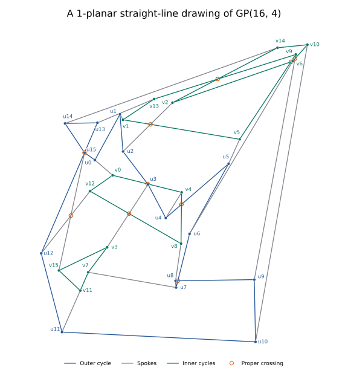

# GP(16,4) 的局部交叉数

**证明署名：** Chain.Ren · 独立研究 · [完整证明](gp16-4-proof.md) · 版本日期：2026-11-26

[固定版本证明](https://github.com/Asakitan/gp16-4/blob/proof-v1.0.1/gp16-4-proof.md) · [GitHub Release 与公开时间](https://github.com/Asakitan/gp16-4/releases/tag/proof-v1.0.1) · [引用信息](CITATION.cff)

广义 Petersen 图 $GP(16,4)$ 的**局部交叉数和直线局部交叉数都是 1**。也就是说，它不是平面图，但可以用直线画出，使每条边至多被交叉一次。

下界来自一个 $K_{4,4}$ 子式。上界由 32 个顶点的整数坐标给出：48 条边中恰有 10 对相交，涉及的 20 条边互不重复。这 10 个交叉点是这幅图的总交叉数，不代表总交叉数最优。该题见 [Schaefer 2026 年综述，第 72 页脚注 130](https://www.combinatorics.org/ojs/index.php/eljc/article/download/DS21/pdf#page=72)。

## 复核

在项目根目录运行（仅需 Python 标准库）：

~~~bash
python -B verify_gp16_4.py
~~~

脚本读取[整数坐标证书](gp16-4-certificate.json)，检查所有三点组与 1,032 对不共端点的边，并输出完整交叉清单。

[完整证明](gp16-4-proof.md) · [项目状态](STATUS.md) · [MIT 许可证](LICENSE)
