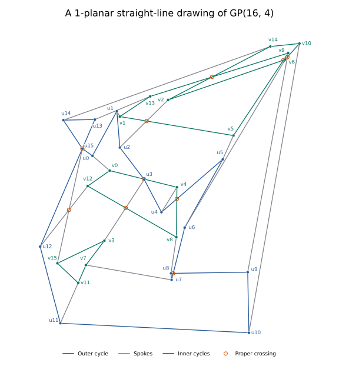

# 广义 Petersen 图 GP(16,4) 的局部交叉数是 1

**署名：** Chain.Ren · 独立研究

**版本：** [proof-v1.0.0](https://github.com/Asakitan/gp16-4/releases/tag/proof-v1.0.0) · 版本日期：2026-11-26（Australia/Sydney）；实际公开时间见 Release。

本证明与验证资料在 OpenAI Codex 的实质协助下形成；不代表学校成果，不主张已完成同行评审或核定全球首证。

**定理。** 广义 Petersen 图 $GP(16,4)$ 有一幅每条边最多被交叉一次的直线画法，但没有平面无交叉画法。因此它的局部交叉数与直线局部交叉数都等于 1。

**公开问题。** Marcus Schaefer 的 [2026 年版《The Graph Crossing Number and Its Variants》，第 72 页脚注 130](https://www.combinatorics.org/ojs/index.php/eljc/article/download/DS21/pdf#page=72) 在引述 Barakezyan 的硕士论文表 5.1 后，把本图列为该表最小的未解情形，候选值为 1 和 2。这里的局部交叉数是：对一幅画法先取**单条边上的最大交叉数**，再对所有画法取最小值；不要求总交叉数最小。

## 1. 图和下界

顶点为 $u_i,v_i$（$0\le i<16$）。下标按模 16 计算，三类边是外圈 $u_i u_{i+1}$、辐条 $u_i v_i$ 和内圈 $v_i v_{i+4}$。

把连续四个外圈点 $A_j=\{u_{4j},u_{4j+1},u_{4j+2},u_{4j+3}\}$ 缩成一个点，$0\le j<4$。把每个内圈四边形 $B_k=\{v_k,v_{k+4},v_{k+8},v_{k+12}\}$ 也缩成一个点，$0\le k<4$。这八个点集两两不交，各自连通。对每一对 $j,k$，辐条 $u_{4j+k}v_{4j+k}$ 连接 $A_j$ 与 $B_k$。删去外圈块之间的边并略去收缩产生的环，便得到 $K_{4,4}$ 作为图的子式。它包含非平面图 $K_{3,3}$；而平面图的子式仍平面。故原图非平面，局部交叉数至少为 1。

## 2. 上界：一幅整数坐标直线图

把每个顶点放到表中的点，两端属于同一条边就连直线段。这张表即完整构造，不需要优化程序或作图软件。

| $i$ | $u_i$ | $v_i$ |
|---:|---:|---:|
| 0 | (-146, 56) | (-117, 31) |
| 1 | (-105, 131) | (-100, 122) |
| 2 | (-100, 70) | (-19, 150) |
| 3 | (-59, 16) | (-126, -87) |
| 4 | (-30, -39) | (-4, 3) |
| 5 | (73, 50) | (91, 90) |
| 6 | (9, -65) | (178, 218) |
| 7 | (-13, -153) | (-157, -128) |
| 8 | (-14, -142) | (-5, -81) |
| 9 | (115, -140) | (183, 229) |
| 10 | (117, -242) | (202, 245) |
| 11 | (-200, -226) | (-170, -158) |
| 12 | (-234, -97) | (-154, 5) |
| 13 | (-142, 117) | (-49, 156) |
| 14 | (-195, 116) | (153, 240) |
| 15 | (-163, 68) | (-205, -125) |

把三类边分别编号为 $i$、$16+i$、$32+i$。按表中坐标，全部内部交叉的无序边对恰好是：

$$
\begin{gathered}
(2,32),\ (4,36),\ (6,8),\ (12,14),\ (18,33),\\
(19,40),\ (25,38),\ (28,31),\ (34,37),\ (41,46).
\end{gathered}
$$

以下是复核该清单所需的全部判据。令
$$
D(a,b,c)=(b_x-a_x)(c_y-a_y)-(b_y-a_y)(c_x-a_x).
$$
在表中 $\binom{32}{3}=4960$ 个三点组上，$D$ 均非零，故顶点互异，无边经过第三个顶点。给定不共端点的线段 $ab,cd$，二者内部相交当且仅当
$$
D(a,b,c)D(a,b,d)<0,\qquad D(c,d,a)D(c,d,b)<0.
$$
例如边 2 是 $u_2u_3$，边 32 是 $v_0v_4$，对应四个行列式依次为 $-2517,2437,4883,-71$，满足两项异号条件。对其余边对作相同计算即可得上述清单：[标准库复核程序](verify_gp16_4.py)使用[同一张整数坐标表](gp16-4-certificate.json)，枚举全部 $\binom{48}{2}-32\binom32=1032$ 对不共端点的边。共端点的边因无三点共线而只相遇在端点。

10 对中的 20 个边号两两不同。因此没有三边共交，20 条边各被交叉一次，28 条边从未被交叉。故这幅直线图的最大逐边交叉数恰为 1。和下界合并即得定理。∎

## 3. 如何复算，结论说明了什么

在项目根目录执行：

~~~powershell
python -B verify_gp16_4.py
~~~

程序仅用 Python 标准库和任意精度整数；若有三点共线、交叉清单与坐标不符或一条边被交叉两次，程序会报错。寻找坐标时用过浮点启发式搜索，但证明只依赖上表和整数判据。SVG 是示意图，不是验证依据。

这个构造确定的是**局部**交叉数；10 是这幅图的总交叉数，并不是对所有画法的总交叉数最小值的主张。本文独立给出可复算解答。公开综述的未解记录与本次查新支持选题，不证明全球发表优先权。
